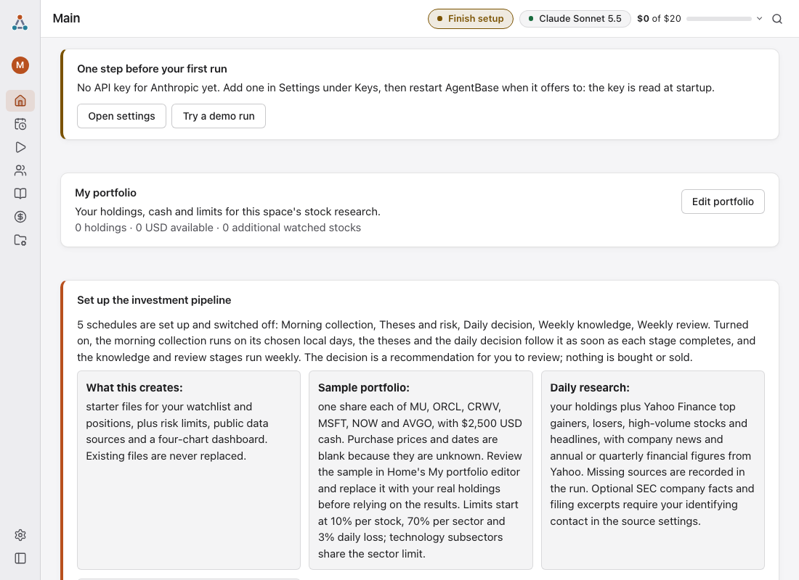

# Getting started

[Guide contents](README.md) · [Next: Running tasks](2_running_tasks.md)

## Install and open AgentBase

Version 0.5.0 ships a Windows x64 installer and a macOS Apple Silicon disk
image. Installed users need neither Python, Node, nor Rust. Use the
[0.5.0 release](https://github.com/Zocke07/AgentBase/releases/tag/v0.5.0) or the
matching artifact from a successful
[build run](https://github.com/Zocke07/AgentBase/actions/workflows/build.yml).
See the [release notes](../releases/0.5.0.md) for status and limitations.

### Windows

1. Download `AgentBase_0.5.0_x64-setup.exe` for an x64 Windows PC.
2. Run the installer. The build is unsigned; if SmartScreen shows **Windows
   protected your PC**, choose **More info → Run anyway** to proceed with the
   downloaded build you trust. A new installer or your machine's security
   policy may produce another warning.
3. Installation is for your account and needs no administrator rights. The
   installer includes a WebView2 bootstrapper for machines missing that runtime.
4. Open **AgentBase** from the Start menu.

### macOS

1. Download `AgentBase_0.5.0_aarch64.dmg` for an Apple Silicon Mac. This
   image is not an Intel or universal build.
2. Open the disk image, drag **AgentBase** onto the **Applications** link, and
   eject the image. Installing it there makes it appear in Spotlight. macOS
   treats apps run directly from the image or Downloads as temporary copies,
   which can produce multiple AgentBase entries in Finder searches. Releases
   before 0.3.2 shipped a zip; delete any of those copies in Downloads and use
   the one in Applications.
3. Open the app from **Applications**. It has no Developer ID signature or
   Apple notarization. If macOS blocks it as an unidentified developer,
   attempt to open it once, then go to **System Settings → Privacy & Security
   → Open Anyway** and confirm the exception. Only do this for the project
   download you intended to run.
   [Apple's instructions](https://support.apple.com/en-us/102445) explain the
   prompts and the exception.

If the installed app remains quarantined, use this Terminal alternative:

```bash
xattr -dr com.apple.quarantine /Applications/AgentBase.app
```

Adjust the path if you installed it elsewhere. This removes the quarantine
attribute from this app and its contents; it does not add a trusted Developer
ID signature or notarization.

A separate **keychain access** prompt can appear after you store a key,
particularly after an upgrade. It names **AgentBase** and
`dev.agentbase.desktop` and may request your **login keychain password**.
Choose **Allow** for this access, or **Always Allow** for this build. It is
asking for the Mac's keychain password, not your model API key. Because these
builds have an ad-hoc code identity, another build may ask again. If you choose
**Deny**, the app starts without that key; quit and reopen it to retry.

## Find your way around



On launch, a short list shows what the app is waiting on: **Starting the
engine** (its local engine), then **Checking your settings** and **Loading your
spaces**, each ticked as it finishes. The first start after installing or
updating can take a minute or two, and the screen says so if it does. If an
earlier AgentBase is still closing, it says it is waiting for that. Once all
three are done, you land on **Home** in the default space. The first launch opens a
short tour of the window and ends on the demo run; **Skip the tour** or Esc
dismisses it permanently, and **Settings → About AgentBase → Replay the tour**
brings it back.

| Control | What it opens |
|---|---|
| Space name at the top of the left rail | Switch spaces, find archived spaces, or choose **New space…**. |
| **Home** | What runs on its own (and, in Main, **Turn on the daily pipeline**), recent **Market alerts**, runs going under **Now** (a desk over each, raising a card when a question waits; with nothing going, the room at rest and when the space next runs on its own), **Run once** for a single task, **Recent runs**, and enabling or disabling agents. |
| **Automations** | What this space runs on its own: schedules at set times or one after another, the market watch that alerts you to sudden price moves, and what an unattended run may do. |
| **Runs** | Open a current run or replay a past one in this space. |
| **Agents** | This space's agents as desks; a desk opens its editor. |
| **Knowledge** | Everything in the space folder, in two sections. **User Summary** lists what was written for you to read (decisions, reviews, alerts, the forecast workbook, charts and notes), each opening in Preview, with every dated report also readable as one page. **Technical Details** holds the raw data and settings: **Recent**, all **Notes**, **Agent files** and automatically managed **Saved context**. |
| **Usage** | This month's model-call costs, tokens, and carried context by day, model, space, and run. |
| **Space settings** | Name, description, folder, model, limits and approval answers for this space. |
| **Settings**, at the bottom | App defaults, keys, shared budget, Discord, theme and the About box. |
| **Hide the sidebar**, beneath Settings | Folds the rail to icons (Ctrl/Cmd+B does the same); names remain in tooltips and the space initial replaces its name. |

In windows narrower than about 1,100 pixels, the rail folds to icons
automatically, and **Show the sidebar** opens it over the page. Esc, a click
outside it, or choosing a section closes it again. Pressing Tab first offers
**Skip to content**, which jumps past the rail to the section.

The header shows the selected space's model (using its maker's name, such as
**Claude Sonnet 5.5**; hover for the provider), this month's spending against your
monthly limit, and approvals waiting across spaces. Click the spending for a
breakdown: this space's share, how many runs there were and what one cost on
average, the models and spaces the money went to (the three largest of each),
and the limit per run, with **See all usage** and **Change limits**. Esc or a
click elsewhere closes it; hover the figure for the ledger's exact amounts. While
setup is unfinished, **Finish setup** opens Settings. Switching spaces changes
what you see; it does not stop runs already in progress.

On a wide window Home is two columns: what you start and set up on the
left, and beside it what is going on (**Now**, **Recent runs** and the
agents); in a narrower one they are one column in the same order.

The magnifying glass at the header's right end, or Ctrl+K (⌘K on a Mac),
opens **Find anything**: type part of a section, an action (**Run once**,
**Make a schedule**, **New space**, the appearance, the tour), another
space, a run's title or goal, an agent or a note, and press Enter. In Main
it also offers **Edit my portfolio** and **Market watch**. Arrow keys move
through the results and Esc closes it. Ctrl+, (⌘, on a Mac) opens Settings,
and Ctrl/Cmd+1 to 8 open the sections in the rail's order.

Right-clicking a run in a list, an agent in **Agents**, a note or folder in
Knowledge's tree, or a desk in a run's office opens a short menu of what
that thing already offers (open it, stop or delete the open run, turn an
agent on or off, fold or delete a folder, inspect a desk). Shift+F10 or the
keyboard's Menu key opens the same menu for whatever has focus. On a Mac,
the window's three buttons sit in the header row, and dragging the header's
empty space moves the window.

A fresh install has no cloud key. **Home** says so in **One step before
your first run** and offers **Open settings**. **Try a demo run** in that
notice shows a scripted run without calling a model or using a key.

Settings is a single page. Its section buttons (**Provider**, **Keys**,
**Budget**, **Limits**, **Chat**, **Appearance**, **About**) jump to each
section; on a wide window they stand in a list at the left, in view as you
scroll, and
**Save settings** remains at the bottom of the window. The first group, **Get
started**, holds the two things a new install needs: the provider new spaces
start on, and its key.

## Connect a model

### Anthropic or OpenAI with an API key

1. Obtain an API key from your provider's account dashboard.
2. In the AgentBase window, open **Settings → Keys**. Click **Set…** beside
   **Anthropic API key** (`anthropic_api_key`) or **OpenAI API key**
   (`openai_api_key`), paste the key, and click **Save key**.
3. Click **Restart AgentBase**, which appears under the key list after you save
   or clear a key, or restart the app yourself. Keys are stored in the OS
   credential store and read when the app starts, so changes take effect only
   after a restart, which stops any run in progress. **Save settings** is
   separate from **Save key**.
4. Under **Settings → Provider**, choose where new spaces start (**New spaces
   use**), then click **Save settings**. Anthropic is the default. Each space
   then keeps its own provider and model under **Space settings → Model**; a
   new one starts on its provider's default (`claude-sonnet-5-5` for
   Anthropic, `gpt-6.1-sol` for OpenAI API access, and `gpt-5.6-sol` for a
   ChatGPT plan; type an Ollama model). Changing this setting moves
   no existing space: to move one, change its provider in Space settings (see
   [Create and configure spaces](#create-and-configure-spaces)). An agent can
   choose its own model in its definition.
5. Click **Check** under **Provider**. A **Ready** result means the saved
   configuration can construct a provider. It does not contact the provider,
   authenticate the key remotely or spend money. Your first run checks the
   real connection.

A space's model dropdown lists the cloud models whose prices this build
knows: the provider's current models first, then older ones it still sells,
each with its level (**flagship**, **high**, **balanced** or **fast**) and its
price in dollars per million tokens read in and written out. A model that is not in its price table is refused before a model call;
an Anthropic dated snapshot such as `claude-haiku-4-5-20251001` is priced as
its alias `claude-haiku-4-5`, so either id works in a space or agent. Keys
are shared by every space. AgentBase displays their names and whether they
are set, never their stored values.

The current API lineup was checked on October 12, 2026:

| Provider | Level | Model | Input / output per million tokens |
| --- | --- | --- | --- |
| Anthropic | Flagship | Claude Fable 5.1 | $10 / $50 |
| Anthropic | High | Claude Opus 5.5 | $4 / $20 |
| Anthropic | Balanced | Claude Sonnet 5.5 | $2 / $10 |
| Anthropic | Fast | Claude Haiku 5.5 | $0.10 / $0.50 |
| OpenAI | Flagship | GPT-6 Astra | $10 / $50 |
| OpenAI | Balanced | GPT-6.1 Sol | $2 / $10 |
| OpenAI | Fast | GPT-6 Luna | $0.10 / $0.50 |

Sources: [Anthropic lineup](https://platform.claude.com/docs/en/models/overview),
[OpenAI pricing](https://developers.openai.com/api/docs/pricing).

These are standard rates for shorter prompts. Haiku 5.5 prompts above
100,000 input tokens cost $0.50 / $2.50 for the entire request.
[Anthropic model documentation](https://platform.claude.com/docs/en/models/haiku-5-5/overview).
GPT-6 models, including GPT-6.1 Sol, charge twice the input rate and 1.5 times
the output rate above 272,000 input tokens for the entire request.
AgentBase applies these tiers to both budget estimates and recorded costs.
[OpenAI model pricing](https://developers.openai.com/api/docs/models/gpt-6.1-sol).
GPT-5.6 Sol uses the same 272,000-input-token threshold, charging $8 / $30
above it and $4 / $20 otherwise.
[GPT-5.6 Sol pricing](https://developers.openai.com/api/docs/models/gpt-5.6-sol).

Untouched example collectors now use Haiku 5.5. Older Haiku 4.5 and GPT-6 Sol
remain selectable, and saved custom choices are preserved. OpenAI schedules
retirement of `gpt-4.1-nano` and `o3-mini` for October 23, 2026; choose a
current model before that date if you use either.
[OpenAI deprecations](https://developers.openai.com/api/docs/deprecations).

Key entry works in the desktop app. A browser showing the development UI can
only display which keys the sidecar received at startup.

### OpenAI with a ChatGPT subscription

1. In **Settings → Provider**, choose **openai** and select **ChatGPT
   subscription** under **OpenAI access**; the model stays each space's own.
2. Click **Sign in with ChatGPT**. AgentBase opens an OpenAI sign-in page in your
   browser. Complete sign-in with the ChatGPT account whose monthly plan you
   want to use, then return to AgentBase.
3. Wait for the account status to show **connected**, then click **Save
   settings**. **Check** confirms that the saved mode has a connected account
   without calling a model.

API-key and ChatGPT access both remain the `openai` provider. They use the same
selected model id, AgentBase agent loop, tool catalogue, approvals, event log,
run limits and normalized token accounting. Switching the access radio is the
only AgentBase behavior change. OpenAI can expose different models and usage
allowances to a ChatGPT plan and an API account: in September 2026 a plan
offered GPT-6 Astra and the GPT-5.6 and GPT-5.5 models, but not GPT-6 Sol or
Luna. Once you are signed in, AgentBase asks the account which models it
includes. The model pickers list those first and show the rest as **Not in
your ChatGPT plan**; a new space, or one switched to OpenAI, starts on a model
the plan includes; Home says when a space's model is not one, and its button
opens **Space settings**. There, a space on OpenAI offers **Use the closest
models it includes** for its own model and for its agents that name one the
plan lacks. A space on GPT-6 Sol or GPT-6.1 Sol is offered GPT-5.6 Sol, the plan's strong
model. A shipped `decision` agent on either Sol model keeps its intended strong
level and moves to GPT-5.6 Sol. Other shipped balanced agents on those models
move to GPT-5.6 Terra. GPT-5.6 Sol counts at twice their short-context price against
the per-run limit, so raise the limit if runs stop there. An agent in a space
on another provider that names an OpenAI model is
changed in its own editor. AgentBase never swaps a model on its own: a run on
a model the plan lacks stops with that reason, and an API key reaches every
model.

The first **Sign in with ChatGPT** downloads the OpenAI Codex App Server
runtime (about 113 MB on macOS, 138 MB on Windows) from PyPI into AgentBase's
data folder. The download is refused unless its size and SHA-256 checksum match
the build AgentBase was released with, and it happens once; later launches
reuse it. Settings shows the progress, and API-key access never needs it. The
ChatGPT credential is then stored by that runtime in the OS credential store.
OAuth tokens are never returned to the AgentBase webview or written to its
database. The runtime is used only to obtain one model decision; AgentBase
still executes every tool through its own approval gate. OpenAI's
[authentication guide](https://learn.chatgpt.com/docs/auth) documents ChatGPT
subscription and API-key access as Codex's two sign-in methods, and its
[App Server guide](https://learn.chatgpt.com/docs/app-server) documents the
browser flow used here.

Direct Claude Free, Pro and Max subscription login is not offered. Anthropic's
[authentication terms](https://code.claude.com/docs/en/legal-and-compliance#authentication-and-credential-use)
do not permit third-party products to offer Claude.ai login or route those
credentials, so the ordinary Anthropic provider continues to require
`anthropic_api_key`. Anthropic separately permits products to embed an
unmodified Claude Code binary under stated conditions; that is a Claude Code
product mode rather than an interchangeable credential transport for this
provider loop.

### Ollama

1. Install and start [Ollama](https://ollama.com), then pull a model. This
   project has completed real runs with `qwen3:4b`:

   ```text
   ollama pull qwen3:4b
   ```

2. In **Settings → Provider**, choose **ollama** and leave **Ollama address**
   at `http://127.0.0.1:11434` for the local daemon. Click **Save settings**.
3. In **Space settings → Model**, type `qwen3:4b` into **Model** and click
   **Save space**, then start a small task from **Home**.

Ollama needs no API key, and its calls add $0 to AgentBase's budget. After the
model is downloaded, local inference works offline. Model capability and
speed depend on the model and your hardware; a successful setup check does
not prove that the daemon is running or the model can finish a task.

## Create and configure spaces

Open the space switcher, select **New space…**, enter a name, and choose
whether to start with **the three starter roles**, **no agents**, or
**copies of the current space's agents**. Click **Create space**. Copies have
their own definitions; later edits to the originals do not update them.

The investment pipeline is Main's alone: **My portfolio**, **Market watch**,
the pipeline's schedules and its seven investment tools (`read_market`,
`read_company_reports`, `read_prices`, `compute_portfolio`, `check_limits`,
`score_predictions` and `track_forecasts`) stay in the default space. A new
space's agents use the general tools: files, knowledge, saved context, web
pages and feeds, and the shell. So a new space cannot start as a copy of
Main's agents, and Knowledge groups its results as notes, daily notes,
workbooks and charts rather than decisions, reviews and alerts.

In **Space settings**, change the name and description, then use **Open
folder** to open the space's files in Explorer or Finder. Put input files
there before asking an agent to read them. File tools are confined to this
folder; shell commands have broader access, as explained in
[Approvals](2_running_tasks.md#approvals).

A space names its own provider and model under **Model**. A new space starts
on the provider chosen in Settings and that provider's default model; change
either here. Choosing another provider moves the model to the current model at
the same level there (Haiku to GPT-6 Luna, Sonnet 5.5 to GPT-6 Sol, Fable to
GPT-6 Astra, and back), and you can pick a different one before saving. GPT-6
Sol covers both balanced and strong work. The shipped `decision` agent keeps
its strong intent across that bridge; other selections map by the model's own
catalog level.

Agents that name a model of the old provider, such as every agent in the
investment roster, would keep using that provider (and need its key). The
switch lists them under **Also move these agents to …?**, each with the model
it would move to, all ticked; untick any to leave it where it is. **Save
space** saves the space and moves the ticked agents, and says how many moved.

Limits are entered under **Limits and approvals**; a blank
limit uses the app default. Click **Save space** to apply changes to future
runs.

There is one important difference between limits and approval policy:

- A space can raise or lower a run limit relative to the app default.
- A space's automatic approvals can only narrow what the app permits. Under
  **Calls that run without asking**, choose **Inherit the app-wide policy**
  or this space's own policy. An own policy with nothing ticked (Supervised) asks for
  every tool call, even if the app permits automatic calls.

Under **Archive or delete**, archiving keeps the history accessible through
**Archived** in the switcher and prevents new runs. **Unarchive** makes the
space active again. Deletion is available only when the space has no runs;
it removes the space and its agent definitions, but leaves its files on disk.
The default space cannot be archived or deleted.

## Change app settings

**Settings** groups defaults for every space above account and app controls.

| Section | Controls |
|---|---|
| **Provider** | The provider new spaces start on, OpenAI API-key or ChatGPT access, and the local Ollama address. A provider's connection shows once new spaces or a space use it; the rest fold under **Other providers**. |
| **Limits and approvals** | Default **Steps per agent** (20), **Agents per run** (5), **Seconds per run** (600), and calls that may run automatically. |
| **Keys** | Store or clear cloud API keys and the Discord bot token; restart to apply. |
| **Monthly budget** | **Monthly cap (USD)**, $20.00 by default, shared across spaces. Enter dollars directly. |
| **Chat channels** | Enable Discord, allow accounts, choose approval responders and the destination space. |
| **Appearance** | **Follow the system**, **Light**, or **Dark**, and **Reduce transparency**, which makes menus and pop-up panels solid instead of see-through. Both change immediately and are remembered on this computer. |
| **About AgentBase** | The version that is running, the data folder with **Open folder**, and **Replay the tour**. |

Click **Save settings** for changed settings. Model, limit and approval
changes affect future runs; an active run keeps its starting configuration.
Discord settings take effect when saved, but changing its stored token still
requires restarting the app. Every space keeps its own provider and model,
so changing the provider here affects only spaces created afterwards.
